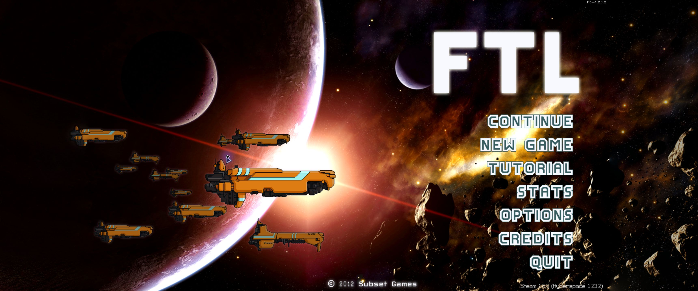
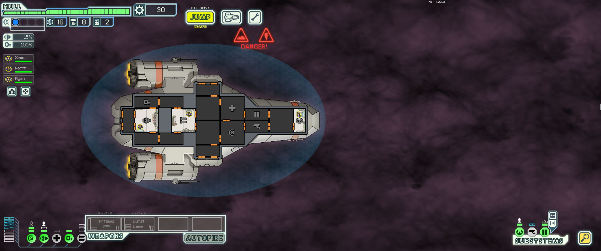

# FTL Ultrawide

An experimental Windows presentation mod for **FTL: Faster Than Light, base game with Advanced Edition**. Adds **Fullscreen (Modded)**, expands the scene, moves the HUD to the edges, and adapts menus, scenery and screen effects for **3440×1440's aspect ratio (43:18)**.

**[Download beta](https://github.com/Gavitron2021/ftl-ultrawide/releases/tag/v0.1.0-beta.6.1)** · **[Install / restore](docs/INSTALL.md)** · **[Agent / LLM setup prompts](docs/AGENT-SETUP.md)** · **[Compatibility](docs/COMPATIBILITY.md)** · **[Report issues](https://github.com/Gavitron2021/ftl-ultrawide/issues/new/choose)**

This is a community-test beta. Selected menus, shops, combat encounters, nebula/storm effects, Credits, startup and original profile import have been checked. **A complete campaign has not been validated.**

Beta.6.1 corrects **Borderless (Modded)** window/focus handling and adds an optional, reversible NVIDIA DXGI presentation setting for smoother app switching and stable streaming. [Borderless setup and scope](docs/BORDERLESS.md). It includes the beta.4 reactor/store changes and earlier UI fixes. [Causes and test scope](docs/BUGFIX-NOTES.md). Existing users: follow the [guarded update procedure](docs/INSTALL.md#update-an-existing-modded-installation).

## Features

- Windowed, Fullscreen (Classic) with the original aspect ratio and side bars, and Fullscreen (Modded). Change the mode in Options, then restart.
- Wider viewport, side-aligned combat HUD and corrected menus, pause, modal darkening, Advanced Information button and loading-screen placement.
- 31 complete gameplay panoramas. Title/hangar retain the original central art, with repaired additions. The hangar worker follows the visible walkway.
- Higher-resolution nebula clouds and lightning preserving native opacity/intensity; full-width nebula/storm layers, hazard flashes and Credits scenery.
- Compatible UI-only selections from Shiny; HighRes planets and Better Asteroids installed locally from separate author downloads.
- Original ship, crew and weapon sprites preserved. Combat data is not intentionally changed by this mod; Hyperspace has engine changes of its own, so exact vanilla equivalence is not guaranteed.

## Requirements

- Owned **Windows Steam FTL**, pristine hash-verified archive and verified **Steam 1.6.9** executable. The builder can roll back the tested **Steam 1.6.14** executable using the separately downloaded official patch. Other versions must first use official rollback tools; unknown files are refused.
- **Hyperspace 1.23.2**, **ftlman 0.7.4** and the exact visual files in [INSTALL.md](docs/INSTALL.md). Newer DLLs are not interchangeable with these version-specific patches.
- **Python 3.11+**, Pillow, write access to the game folder and a supported primary display. The release ZIP supplies our compiled launcher; a source build also needs MSVC x86 tools.

No game executable, full `ftl.dat`, save, local backup or upstream visual mod is distributed. The builder reconstructs a private installation payload from each player's own files. Do not upload that generated payload.

## Required visual mod downloads

Get these exact inputs from their authors. All four are required by the current builder; this beta does not provide an optional-dependency selection. Place them in your dependency folder **without installing them separately into FTL**. Our builder applies the compatible selection and load order locally. In particular, it uses only selected UI resources from the full Shiny archive.

| Visual mod | Author download / project | Required file |
| --- | --- | --- |
| HighRes Backgrounds & Planets **2.0**, by Ouaz and upstream artists | [Download .ftl](https://github.com/Ouaz/FTL-diversityMod/raw/master/other/HighRes_Backgrounds_and_Planets_2.0.ftl) · [Project and credits](https://github.com/Ouaz/FTL-diversityMod#highres-backgrounds--planets-v20) | `HighRes_Backgrounds_and_Planets_2.0.ftl` |
| Better Asteroids, by sanmonku | [Standalone download page](https://www.moddb.com/mods/better-planets-and-backgrounds/downloads/better-asteroids) | Extract the ZIP to obtain `better_asteroids.ftl` |
| Shiny! UI and Graphics **v1.0 Vanilla**, by Russian Rockman | [Author thread and downloads](https://www.subsetgames.com/forum/viewtopic.php?f=11&t=25839) — choose **Vanilla v1.0** | `Shiny_UI_and_Graphics_v1.0_Vanilla.ftl` |
| Shiny Combat UI **2.0**, by Ouaz, based on Russian Rockman's UI | [Download .ftl](https://github.com/Ouaz/FTL-diversityMod/raw/master/other/Shiny_Combat_UI_2.0.ftl) · [Project and credits](https://github.com/Ouaz/FTL-diversityMod#shiny-combat-ui-20) | `Shiny_Combat_UI_2.0.ftl` |

Files are checked against [`release/dependencies.json`](release/dependencies.json). Keep `.ftl` archives intact; extract only outer ZIPs that contain the required files. The [installation guide](docs/INSTALL.md#downloads) also links the pinned Hyperspace, ftlman and rollback inputs. If a link fails or the contents change, report it rather than substituting a different version.

Using an LLM or coding agent to help? **[Copy the setup prompt](docs/AGENT-SETUP.md)**. It covers display checks, the exact downloads, local preparation, save preservation, verification and a separate installation step. Use an agent with local file/command access; a text-only chatbot can guide you through the steps but cannot perform or verify them itself.

## Display sizes

Only **3440×1440** has hardware testing. The **1720×720 logical canvas** scales 2× at that resolution. A higher resolution at the **same exact ratio**, e.g. **6880×2880**, should scale uniformly, but is untested and adds no new sprite detail. Non-integer scaling can look softer.

“21:9” displays can have different ratios: **2560×1080, 3840×1600 and 5120×2160 are not the same as 3440×1440**. This beta rejects Modded mode unless the calculated logical width is 1720. **32:9 is unsupported.** Use Classic for other ratios. [Display table and remaining limits](docs/COMPATIBILITY.md).

## Saves and artwork

Installation backs up existing `.sav` files without replacing them. On first creation, Hyperspace imports vanilla ships, achievements and statistics from `ae_prof.sav` into **`hs_ultrawide_prof.sav`**. Existing mod progress is reused; this is not continuous synchronization. New progress does not sync back to vanilla. Migration of an active vanilla Continue run is not promised. Check Stats and ships immediately after first launch.

Gameplay panoramas were made with **ImageGen**, using existing scenery as style/context references, then curated and reviewed. Title/hangar additions and cloud detail combine generation with conventional compositing, sampling, alignment and color matching. Lightning uses conventional upscaling to preserve its effect. [Credits, provenance and license scope](CREDITS.md).

Multiverse, Captain's Edition, other overhauls, other operating systems, other aspect ratios and localization layouts are unvalidated. Steam updates/Verify Integrity can replace the mod. Restore before returning to vanilla.
